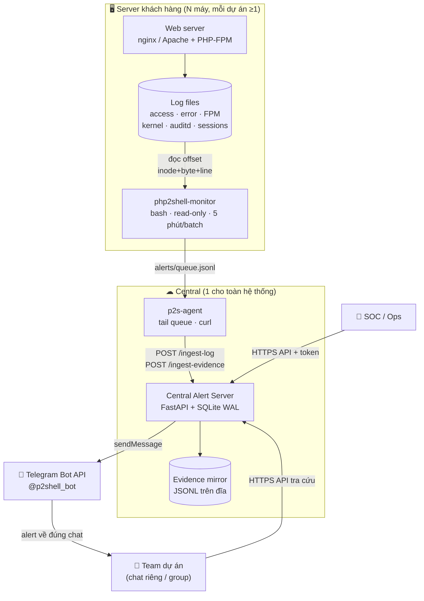
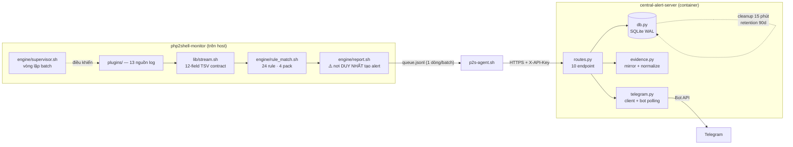
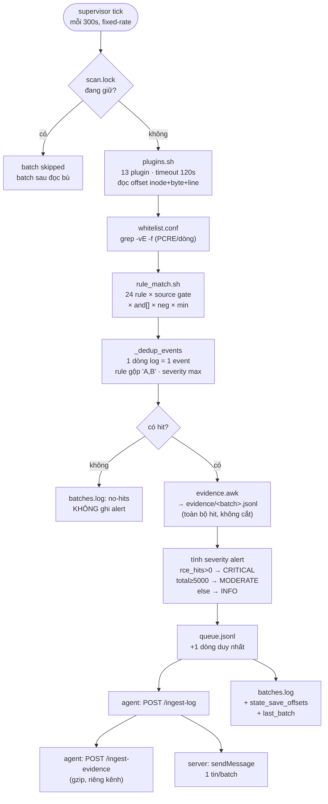
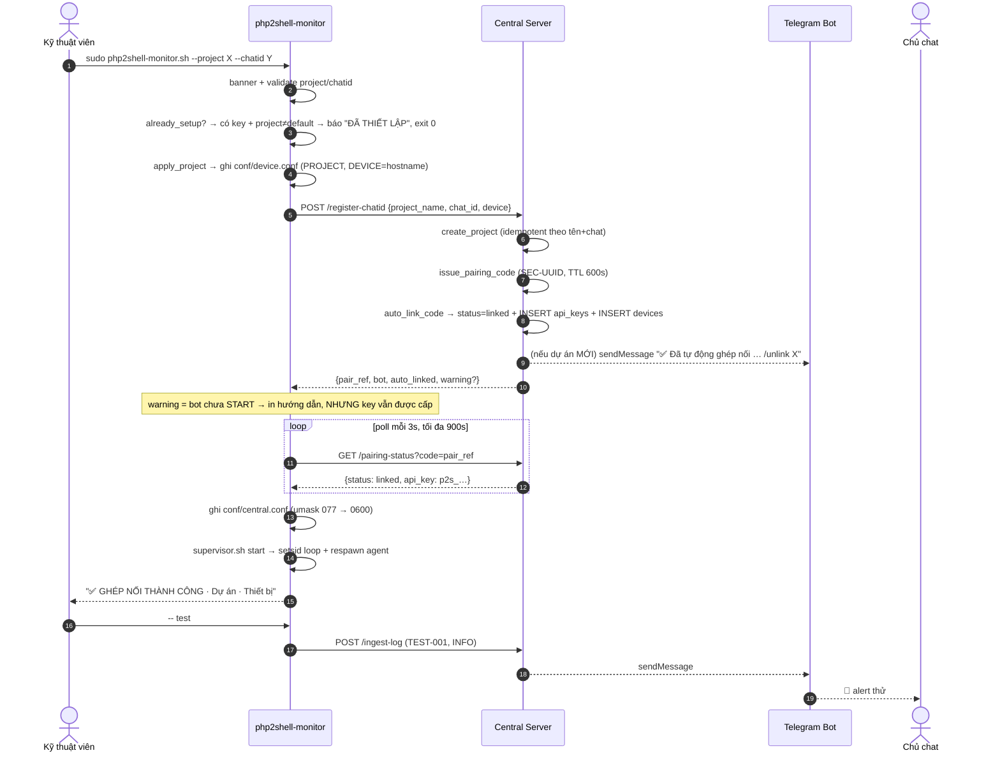
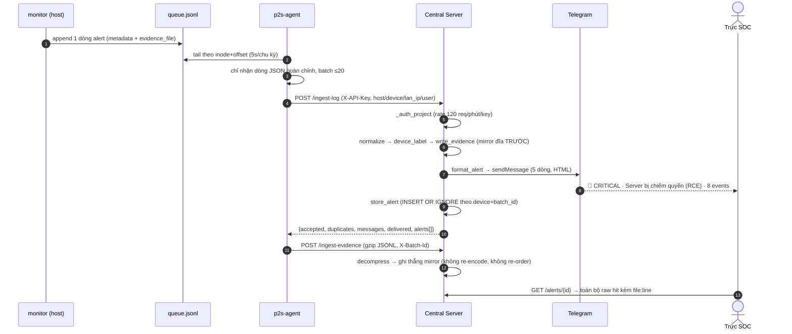
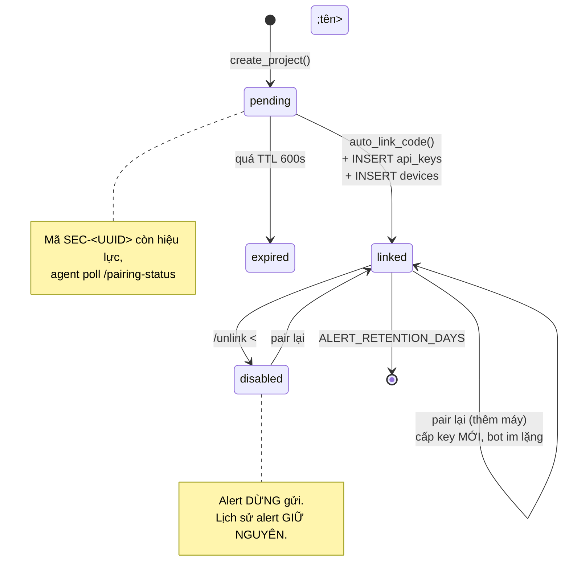
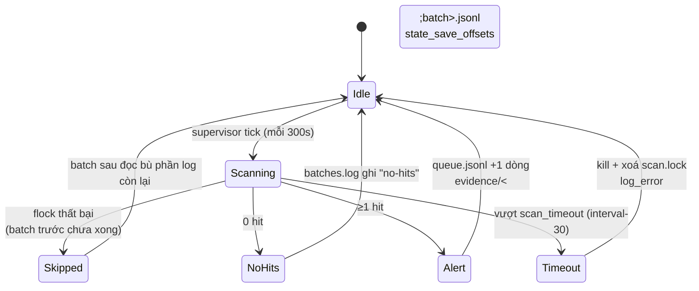
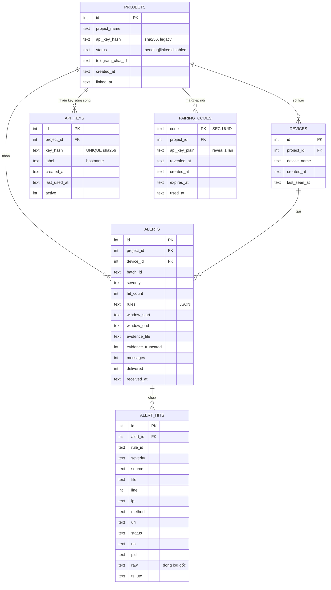
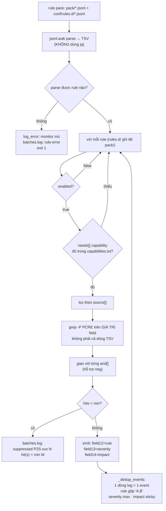
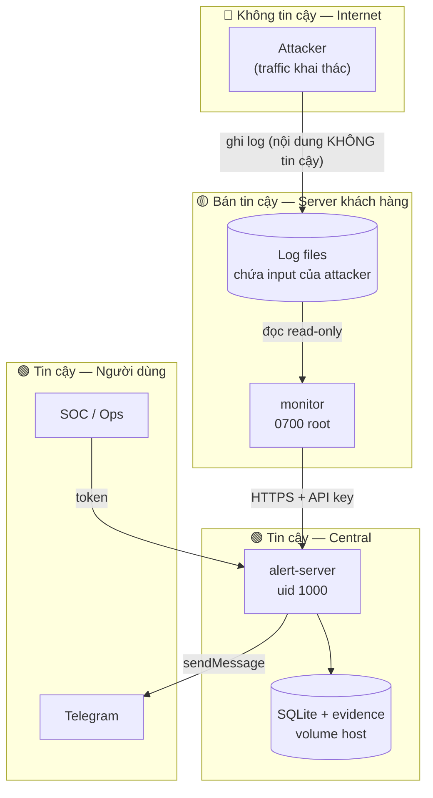

# PRD — PHP2Shell Monitor & Central Alert Platform

| | |
|---|---|
| **Tên sản phẩm** | PHP2Shell Monitor + Central Security Alert Server |
| **Mã tài liệu** | PRD-P2S-001 |
| **Phiên bản tài liệu** | 1.0 |
| **Ngày phát hành** | 26/10/2026 |
| **Phiên bản sản phẩm** | `php2shell-monitor` 1.2.0 · `central-alert-server` 1.0.0 |
| **Nhánh phát triển** | `feature/chatid-pairing` (33 commit) |
| **Trạng thái** | Đã triển khai, đang vận hành thực tế (production-ready) |
| **Đối tượng đọc** | Leader kỹ thuật · Trưởng nhóm SOC · Kỹ sư triển khai · Kỹ sư bảo trì |

---

## Mục lục

1. [Tóm tắt điều hành](#1-tóm-tắt-điều-hành)
2. [Bối cảnh & vấn đề](#2-bối-cảnh--vấn-đề)
3. [Mục tiêu, phạm vi, tiêu chí thành công](#3-mục-tiêu-phạm-vi-tiêu-chí-thành-công)
4. [Đối tượng người dùng & use case](#4-đối-tượng-người-dùng--use-case)
5. [Kiến trúc hệ thống](#5-kiến-trúc-hệ-thống)
6. [Thành phần chi tiết](#6-thành-phần-chi-tiết)
7. [Luồng nghiệp vụ](#7-luồng-nghiệp-vụ)
8. [Mô hình dữ liệu](#8-mô-hình-dữ-liệu)
9. [Mô hình phát hiện](#9-mô-hình-phát-hiện)
10. [Yêu cầu chức năng](#10-yêu-cầu-chức-năng)
11. [Yêu cầu phi chức năng](#11-yêu-cầu-phi-chức-năng)
12. [Bảo mật & mô hình mối đe dọa](#12-bảo-mật--mô-hình-mối-đe-dọa)
13. [Triển khai & vận hành](#13-triển-khai--vận-hành)
14. [Kiểm thử & đảm bảo chất lượng](#14-kiểm-thử--đảm-bảo-chất-lượng)
15. [Rủi ro & giảm thiểu](#15-rủi-ro--giảm-thiểu)
16. [Lộ trình phát triển](#16-lộ-trình-phát-triển)
17. [Phụ lục](#17-phụ-lục)

---

## 1. Tóm tắt điều hành

**PHP2Shell Monitor** là một nền tảng phòng thủ hai thành phần, phát hiện và cảnh báo khai thác hai lỗ hổng nghiêm trọng **CVE-2026-109618** và **CVE-2026-109619** (nhóm lỗi *PHP2Shell* trong PHP 8.2.x/8.3.x/8.4.x/8.5.x liên quan cơ chế `PHP_SESSION_UPLOAD_PROGRESS`), gây **memory exhaustion** và **Use-After-Free** dẫn tới **RCE không cần xác thực**.

Hệ thống gồm:

| Thành phần | Vai trò | Công nghệ |
|---|---|---|
| **`php2shell-monitor`** | Engine phát hiện chạy trên từng server khách hàng. Đọc log read-only, chấm 24 rule qua 4 tầng, xuất alert JSONL | Pure Bash + awk, zero-dependency |
| **`central-alert-server`** | Kho tập trung: nhận alert, lưu SQLite + mirror evidence, bắn Telegram theo dự án | Python 3.11+, FastAPI, SQLite (WAL) |
| **`p2s-agent`** | Cầu nối: tail queue của monitor, đẩy alert + evidence về central | Bash + curl |
| **`docker-lab`** | Môi trường lab tái hiện kill-chain để kiểm thử detection | Docker Compose |

**Điểm khác biệt cốt lõi** — mô hình **"một batch = một alert"**:

> Mỗi 5 phút, mỗi thiết bị tạo **tối đa MỘT** cảnh báo. Cảnh báo đó mang theo **toàn bộ dòng log gốc** đã khớp rule, kèm `file:line` để mở lại đúng vị trí trong log. Không correlation, không scoring, không dedup ở mức alert — người trực nhận đúng một thông báo và toàn bộ bằng chứng trong đó. (Dedup chỉ diễn ra ở mức **event**: một dòng log thoả nhiều rule vẫn là một event — xem §9.6.)

Thiết kế này loại bỏ hoàn toàn hai bệnh kinh điển của hệ thống cảnh báo: **alert fatigue** (một đợt tấn công 300.000 request không tạo 300.000 tin nhắn) và **mất bằng chứng** (alert không bao giờ chỉ nói "có tấn công", nó chỉ đúng dòng log).

**Quy mô hiện tại**: 3.536 dòng Bash/awk (monitor) · 1.947 dòng Python (server) · 376 dòng agent · 24 rule · 13 plugin nguồn log · 114 assertion engine + 43 test server + 19 check e2e — **tất cả pass**.

---

## 2. Bối cảnh & vấn đề

### 2.1 Lỗ hổng

| Thuộc tính | Giá trị |
|---|---|
| **CVE** | CVE-2026-109618 (memory exhaustion) · CVE-2026-109619 (Use-After-Free) |
| **CVSS** | 9.8 / 9.2 — CRITICAL |
| **CWE** | CWE-416 (Use After Free), CWE-400 (Uncontrolled Resource Consumption) |
| **Phiên bản ảnh hưởng** | PHP < 8.2.35 · < 8.3.36 · < 8.4.27 · < 8.5.12; PHP ≤ 8.1 (EOL) |
| **Phiên bản đã vá** | 8.2.35 · 8.3.36 · 8.4.27 · 8.5.12 (phát hành 21/10/2026, 14:00 UTC) |
| **Vector** | `POST` multipart chứa field `PHP_SESSION_UPLOAD_PROGRESS`, không cần xác thực |
| **SAPI ảnh hưởng** | Apache mod_php (**rủi ro cao nhất**) · PHP-FPM · php-cgi · FrankenPHP · LiteSpeed |
| **Khai thác công khai** | Có — đã ghi nhận khai thác thực tế trong tự nhiên |

### 2.2 Cơ chế tấn công (kill-chain)

```
BƯỚC 1 — Dò (T1, HTTP layer)
  POST /upload.php  multipart/form-data
  Content-Length: 15.000.341            ← body lớn bất thường
  ------WebKitFormBoundary
  Content-Disposition: form-data; name="PHP_SESSION_UPLOAD_PROGRESS"
  Content-Disposition: form-data; name="a[b][c][d]"   ← lồng sâu ≥3 tầng
  (nhiều field upload-progress trùng lặp trong 1 request)

BƯỚC 2 — Khai thác (T2, host layer)
  PHP engine cấp phát session upload_progress trong bộ nhớ
  → "Allowed memory size of X bytes exhausted"
  → worker chết: "child 42 exited on signal 11 (SIGSEGV)"
  → kernel: segfault at / Out of memory: Killed process
  → session file /var/lib/php/sessions/sess_<id> chứa payload PHP

BƯỚC 3 — Hậu khai thác (T3, proof of RCE)
  LFI include() session file  →  code chạy với quyền web worker
  → webshell rơi vào webroot (shell.php mới)
  → php-fpm spawn sh/bash/curl/python
  → reverse shell: /dev/tcp/, mkfifo, nc -e, bash -i
  → auto_prepend_file trong .user.ini (backdoor bền vững)
```

### 2.3 Vấn đề cần giải quyết

| # | Vấn đề | Hệ quả nếu không giải quyết |
|---|---|---|
| P1 | **Không thể vá ngay toàn bộ fleet** — hàng trăm server, nhiều bản PHP vendor đóng gói, backport không đổi số version | Cửa sổ phơi nhiễm kéo dài nhiều tuần; attacker có đủ thời gian |
| P2 | **Không biết mình đã bị khai thác chưa** — log phân tán trên từng máy, không ai đọc | Bị chiếm quyền mà không biết; mất dữ liệu khách hàng |
| P3 | **Cảnh báo WAF/IDS rời rạc** — mỗi nơi một định dạng, không có chỗ tra cứu tập trung | Điều tra sự cố mất hàng giờ, không dựng lại được timeline |
| P4 | **Triển khai thủ công không mở rộng được** — copy config tay cho 1000 máy | Sai sót cấu hình, thiếu máy, alert rơi vào sai người |
| P5 | **Bằng chứng bị mất** — alert chỉ nói "có tấn công", không giữ log gốc | Không thể chứng minh, không thể điều tra, không thể báo cáo |

---

## 3. Mục tiêu, phạm vi, tiêu chí thành công

### 3.1 Mục tiêu

| ID | Mục tiêu | Đo lường |
|---|---|---|
| **G1** | Phát hiện khai thác PHP2Shell ở cả 3 giai đoạn: đang dò → đang khai thác → đã chiếm quyền | Có ≥1 rule cho mỗi tầng T1/T2/T3, chạy được trên log thật |
| **G2** | Cảnh báo tới đúng người phụ trách trong ≤ 6 phút kể từ request tấn công đầu tiên | `BATCH_INTERVAL=300` + agent poll 5s + Telegram |
| **G3** | Mọi alert phải truy vết được về dòng log gốc | 100% hit có `file` + `line` + `raw` |
| **G4** | Triển khai một máy mới bằng **một lệnh duy nhất** | `sudo php2shell-monitor.sh --project X --chatid Y` |
| **G5** | Không thay đổi hệ thống đích (read-only) | 0 file ghi ngoài `$WORKDIR`; 0 cron/systemd/user tạo thêm |
| **G6** | Chịu được fleet ≥1000 thiết bị mà không spam chat | Bot chỉ nhắn 1 tin/dự án mới; pairing im lặng khi thêm máy |
| **G7** | Hoạt động trên host tối giản, offline, image bất biến | Không cần Python/Perl/jq trên host đích |

### 3.2 Phạm vi

**Trong phạm vi:**

- Phát hiện khai thác CVE-2026-109618/109619 trên Linux web server (nginx, Apache, PHP-FPM, mod_php).
- Đọc và phân tích: access log, error log, FPM log, kernel log, auditd, session dir, webroot manifest, ModSecurity audit, docker logs, `/proc`, log ứng dụng CMS.
- Tập trung hoá alert đa dự án, đa thiết bị; phân phối qua Telegram.
- Tra cứu, tìm kiếm, kiểm kê thiết bị qua HTTP API.
- Lab tái hiện kill-chain để kiểm thử.

**Ngoài phạm vi (non-goals):**

- ❌ **Vá lỗ hổng** — hệ thống này phát hiện, không vá. Việc nâng PHP lên 8.2.35/8.3.36/8.4.27/8.5.12 là hành động song song bắt buộc.
- ❌ **Chặn tấn công** (IPS/WAF inline) — chỉ đọc log, không can thiệp traffic.
- ❌ **Endpoint detection** (EDR) — không quét memory, không hook syscall.
- ❌ **Network-based detection** — không bắt packet; traffic mã hoá/tunnel là điểm mù, bù bằng lớp WAF/IDS triển khai song song.
- ❌ **Windows/IIS** — hiện chỉ hỗ trợ Linux (mở rộng ở Pha 5).
- ❌ **Multi-tenant SaaS UI** — hiện chỉ có HTTP API + Telegram, chưa có web dashboard.

### 3.3 Tiêu chí thành công (Acceptance)

| # | Tiêu chí | Ngưỡng | Trạng thái |
|---|---|---|---|
| A1 | Test engine monitor | 100% pass | ✅ 114/114 |
| A2 | Test server | 100% pass | ✅ 43/43 |
| A3 | Test e2e (monitor → agent → server) | 100% pass | ✅ 19/19 check |
| A4 | False positive trên traffic benign | 0 | ✅ 0 |
| A5 | Tỉ lệ alert có đầy đủ `file:line` | 100% | ✅ |
| A6 | Thời gian cài đặt một máy | ≤ 3 phút | ✅ |
| A7 | Kill-chain T1+T2+T3 phát hiện đầy đủ trên lab | 3/3 tầng | ✅ đã chạy thật trên VPS |
| A8 | Chạy được khi host không có `jq` | Có | ✅ có test riêng |

---

## 4. Đối tượng người dùng & use case

### 4.1 Personas

| Persona | Vai trò | Nhu cầu chính | Điểm chạm |
|---|---|---|---|
| **P-A · Kỹ thuật viên triển khai** | Cài đặt trên server khách hàng | Một lệnh, không đọc tài liệu dài, không cấu hình tay | SSH + `php2shell-monitor.sh` |
| **P-B · Trực SOC / Ops** | Nhận và xử lý cảnh báo | Biết ngay *máy nào, dự án nào, mức độ nào*; mở được log gốc | Telegram + `GET /api/v1/alerts/{id}` |
| **P-C · Quản lý dự án / Leader** | Nắm tình hình fleet | Danh sách dự án, số thiết bị, mức độ nghiêm trọng cuối | Telegram `/list` + `/api/v1/devices` |
| **P-D · Kỹ sư bảo mật** | Điều tra sự cố | Tìm theo IP/URI/file/nội dung log trên toàn bộ fleet | `GET /api/v1/search?q=` |
| **P-E · Kỹ sư phát triển** | Bảo trì rule pack & engine | Sửa rule không phá vỡ hợp đồng stream/alert; test tự động | `tests/run_tests.sh`, `build.sh` |

### 4.2 Use case chính

| ID | Use case | Actor | Mô tả |
|---|---|---|---|
| **UC-1** | Triển khai monitor lên server mới | P-A | Một lệnh `--project --chatid` → ghi identity, pair, lấy API key, bật supervisor |
| **UC-2** | Nhận cảnh báo tấn công | P-B | Telegram nhận tin 5 dòng, bấm tra cứu để xem toàn bộ hit |
| **UC-3** | Điều tra một IP tấn công | P-D | `GET /search?q=<ip>` trả về mọi dòng log khớp trên mọi dự án được phép |
| **UC-4** | Kiểm kê fleet | P-C | Telegram `/list` hoặc `GET /devices` |
| **UC-5** | Ngắt một dự án khỏi chat | P-C | `/unlink <tên>` — alert dừng gửi, lịch sử giữ nguyên |
| **UC-6** | Săn lại log cũ (retro-hunt) | P-A | `-- retro` quét cả log đã rotate/gzip, xuất đúng một alert |
| **UC-7** | Kiểm tra máy đã vá chưa | P-A | `-- discover` đọc changelog package, phân loại PATCHED/LIKELY VULNERABLE |
| **UC-8** | Tái hiện tấn công trong lab | P-E | `docker compose up` + `loop-rce.sh` sinh traffic thật, kiểm detection |
| **UC-9** | Thêm thiết bị vào dự án đã có | P-A | Chạy lại lệnh pair trên máy mới, cùng `--project`/`--chatid` — bot im lặng |
| **UC-10** | Xoay API key / đổi chat nhận | P-A | `--force` khi chạy lệnh triển khai |

---

## 5. Kiến trúc hệ thống

### 5.1 Sơ đồ ngữ cảnh (C4 Level 1)



### 5.2 Sơ đồ container (C4 Level 2)



### 5.3 Sơ đồ triển khai (deployment topology)

```
┌─────────────────────────────── SERVER KHÁCH HÀNG (web01) ──────────────────────────────┐
│                                                                                         │
│  /var/log/{nginx,apache2,php*-fpm}.log   /var/lib/php/sessions   /var/www   /proc       │
│         │  (READ-ONLY — monitor không bao giờ ghi)                                      │
│         ▼                                                                               │
│  ╔═══════════════════════════════════════════════════════════════════════════════════╗  │
│  ║  /opt/php2shell-monitor/       (0700 root:root — thư mục DUY NHẤT tool tạo ra)    ║  │
│  ║  ├── lib/ engine/ plugins/ rules/ discovery/ export/   ← code (ghi đè khi upgrade)║  │
│  ║  ├── conf/          ← device.conf, default.conf, whitelist.conf (GIỮ khi upgrade) ║  │
│  ║  ├── conf/central.conf   ← SERVER_URL + API_KEY + PROJECT_NAME + CHAT_ID (0600)   ║  │
│  ║  └── projects/<project>/devices/<device>/                                          ║  │
│  ║       ├── alerts/queue.jsonl      ← 1 dòng / batch có hit                          ║  │
│  ║       ├── evidence/<batch>.jsonl  ← toàn bộ hit, không cắt                          ║  │
│  ║       ├── state/{offsets.tsv,capabilities.txt,last_batch}                           ║  │
│  ║       └── run/{batches.log,scan.log,plugin_status.tsv,supervisor.pid,agent/}         ║  │
│  ╚═══════════════════════════════════════════════════════════════════════════════════╝  │
│                    ▲ supervisor (5 phút/batch)        │ agent (5 giây/chu kỳ)          │
└────────────────────┼───────────────────────────────────┼────────────────────────────────┘
                     │                                   │ HTTPS + X-API-Key
┌────────────────────┼───────────────────────────────────▼────────────────────────────────┐
│                    │              CENTRAL SERVER (VPS, 1 cho toàn hệ thống)             │
│                    │   ┌─────────────────────────────────────────────────────────────┐   │
│                    │   │ Docker: p2s-central-alert (uvicorn :8000, uid 1000)        │   │
│                    │   │   FastAPI → SQLite WAL + Telegram polling + cleanup 15'     │   │
│                    │   └──────────────────────┬──────────────────────────────────────┘   │
│                    │                          ▼                                          │
│                    │   /home/.../data-server/  (volume mount ra host)                    │
│                    │   ├── alerts.db                                                     │
│                    │   └── evidence/<project>/IP-LAN_<ip>_<hostname>/<batch>.jsonl        │
│                    └──────────────────────────┬──────────────────────────────────────────┘
│                                               │ sendMessage
│                                    ┌──────────▼──────────┐
│                                    │  Telegram Bot API   │
│                                    └──────────┬──────────┘
│                                               ▼
│                            📱 Chat riêng / Group của từng dự án
└─────────────────────────────────────────────────────────────────────────────────────────┘
```

### 5.4 Nguyên tắc kiến trúc (bất biến thiết kế)

| # | Nguyên tắc | Lý do | Cơ chế thực thi |
|---|---|---|---|
| **I1** | **Read-only trên host** | Monitor không được là rủi ro mới | Mọi ghi nằm dưới `$WORKDIR`; không cron/systemd/user/`/etc`/`/var`/`/usr/local/bin` |
| **I2** | **Một batch = một alert** | Chống alert fatigue, buộc phải có bằng chứng | `report.sh` là nơi **duy nhất** tạo alert; `queue.jsonl` append đúng 1 dòng/batch |
| **I3** | **Bằng chứng không mất** | Alert không có log gốc là alert vô dụng | Mỗi hit giữ `file`+`line`+`raw`; `evidence_file` luôn đầy đủ kể cả khi inline bị cắt |
| **I4** | **Không nguồn nào bắt buộc** | Host nào cũng khác nhau | Plugin thiếu nguồn → im lặng; rule thiếu capability → tắt, ghi lý do vào status |
| **I5** | **Zero-dependency trên host** | Image bất biến, host offline, container tối giản | Bash + awk + coreutils; `jq` là tuỳ chọn (rule pack đọc bằng `lib/jsonl.awk`) |
| **I6** | **Idempotent** | Retry mạng không được tạo alert trùng | `UNIQUE(device_id, batch_id)`; offset theo inode; pairing kiểm tra conf trước khi gọi |
| **I7** | **Ghép nối tự động** | 1000 máy không ai ngồi confirm từng cái | `register-chatid` cấp key ngay; bot chỉ nhắn 1 tin/dự án mới |

---

## 6. Thành phần chi tiết

### 6.1 `php2shell-monitor` — Engine phát hiện

**Vị trí**: `/opt/php2shell-monitor` trên mỗi server khách hàng · **1.2.0** · 3.536 dòng Bash/awk.

#### 6.1.1 Cây mã nguồn

```
src/
├── main.sh                 CLI dispatcher: setup | once | run | test | status
│                           | stop | discover | retro | export | clean
├── bootstrap.sh            makeself entry: root check → seed conf/ → prune code cũ
│                           → chown root:root → chmod 0700/0600 → exec main.sh
├── conf/
│   ├── device.conf         PROJECT + DEVICE (giữ nguyên khi upgrade)
│   ├── default.conf        BATCH_INTERVAL, MAX_EVIDENCE_INLINE, đường dẫn log
│   ├── rules.conf          ghi chú override rule
│   └── whitelist.conf      1 PCRE/dòng, áp lên cả record
├── lib/                    1.094 dòng — nền tảng
│   ├── common.sh           hằng số, utc_now, lan_ip, p2s_want_jq
│   ├── paths.sh            PROJECT/DEVICE → projects/<p>/devices/<d>/*
│   ├── stream.sh           12-field TSV contract + emit_record
│   ├── state.sh            offsets (inode/byte/line) + merge flock
│   ├── json.sh             json_escape / json_str / json_obj (không fork)
│   ├── jsonl.awk           parser rule pack (thay jq)
│   ├── accesslog.awk       parser access log (nginx/apache), giữ FILENAME+FNR
│   ├── fpmlog.awk          parser FPM log
│   ├── evidence.awk        stream TSV → evidence JSONL + counts (1 process)
│   ├── endpoint.sh         endpoint central server (XOR+base64, chống grep)
│   ├── log.sh              log_info/warn/error → run/engine.log
│   ├── time_utc.sh         chuẩn hoá timestamp mọi định dạng log
│   └── deps.sh             best-effort cài jq (không bao giờ chặn batch)
├── engine/                 1.055 dòng — lõi
│   ├── scan.sh             1 batch: plugins → whitelist → rule_match → report
│   ├── plugins.sh          chạy 13 plugin, cô lập lỗi, timeout
│   ├── rule_match.sh       khớp rule trên TỪNG field, source gate, and/neg/min
│   ├── report.sh           ⚠️ gom hit → MỘT alert + evidence/<batch>.jsonl
│   ├── supervisor.sh       vòng lặp batch fixed-rate + PID/lock + respawn agent
│   ├── central.sh          pair | agent | test (forwarder)
│   └── status.sh           báo cáo trạng thái thiết bị
├── plugins/                693 dòng — 13 nguồn log
├── rules/pack/             24 rule JSONL, 4 tầng
├── discovery/              299 dòng — discovery.sh, retro_hunt.sh, patch_status.sh
└── export/export_json.sh   copy alert + evidence ra export/
```

#### 6.1.2 13 plugin nguồn log

| Plugin | Nguồn đọc | Record phát ra | Vai trò |
|---|---|---|---|
| `accesslog_nginx` | `/var/log/nginx/access.log`, `*access*.log` | `access_log` | T1 — dò & khai thác qua HTTP |
| `accesslog_apache` | Apache access log | `access_log` | T1 |
| `fpm` | `/var/log/php*-fpm*.log`, cPanel FPM | `fpm_error` | **T2 mạnh nhất** — OOM, segfault |
| `apache_error` | `error.log`, `error_log` | `apache_error` | T2 — mod_php crash |
| `nginx_error` | `/var/log/nginx/error.log` | `nginx_error` | T2 — upstream 502/timeout loop |
| `kernel` | `journalctl -k`, `/var/log/kern.log` | `kernel` | T2/T3 — segfault, OOM-kill |
| `auditd` | `/var/log/audit/audit.log` | `auditd` | **T3** — execve, ghi file |
| `sessions` | `/var/lib/php/sessions`, cPanel sessions | `sessions` | T2 — key `upload_progress_*`, file phình |
| `webroot_manifest` | `/var/www`, `public_html`, … | `webroot` | **T3** — file PHP mới/thay đổi |
| `modsec` | ModSec audit log, njs, Suricata | `modsec` | T1 — đọc output WAF có sẵn |
| `docker_logs` | `docker logs --since 10m` | `docker` | T2 — PHP trong container |
| `proc_tree` | `/proc/*/{stat,comm,cmdline}` | `proc` | **T3** — php-fpm spawn shell |
| `appcms` | WordPress debug.log, Laravel log | `appcms` | T2 — fatal error ứng dụng |

**Hợp đồng plugin**: kiểm tra nguồn tồn tại trước khi đọc (thiếu → im lặng, exit 0); ghi record ra stdout; xử lý log rotation (`.1`, `.gz`); exit ≠ 0 → ghi `plugin_status.tsv` và **không làm hỏng batch**.

#### 6.1.3 CLI

| Lệnh | Chức năng |
|---|---|
| `--project <tên> --chatid <id>` | **Triển khai một lệnh**: validate → ghi identity → pair → lấy API key → bật supervisor + agent |
| `--force ...` | Ghi đè cấu hình đã có (cấp API key mới, đổi chat) |
| `once` | Chạy một batch ngay (debug/kiểm thử) |
| `run` | Bật supervisor nền |
| `test` | Gửi một alert thử, xác nhận đường truyền Telegram |
| `status` | Supervisor, project/device, plugin lần cuối, capabilities, 5 batch gần nhất, alert cuối |
| `stop` | Dừng supervisor + agent (verify PID trước khi kill) |
| `discover` | Rà host read-only: map log, patch status, capabilities |
| `retro` | Săn một lượt trên log đã rotate/gzip → đúng một alert |
| `export` | Copy alert queue ra `export/` |
| `clean` | stop + `rm -rf` chính `$WORKDIR` (gỡ sạch) |

### 6.2 `central-alert-server`

**Vị trí**: VPS trung tâm · **1.0.0** · 1.947 dòng Python · FastAPI + SQLite WAL.

#### 6.2.1 Cấu trúc

```
central-alert-server/
├── server/
│   ├── app/
│   │   ├── main.py        lifespan: init DB → migrate → bot polling → cleanup 15'
│   │   ├── config.py      env/.env → Config (dataclass, không bắt buộc pydantic)
│   │   ├── db.py          schema + toàn bộ query (636 dòng)
│   │   ├── evidence.py    normalize payload + mirror raw hits ra đĩa
│   │   ├── routes.py      10 endpoint: pairing, ingest, query, admin, health
│   │   ├── telegram.py    TelegramClient (rate ≤1 msg/s) + PairingBot + formatter
│   │   ├── security.py    API key, pairing code, RateLimiter, AttemptGuard
│   │   └── migrate.py     backfill devices, gộp thư mục evidence kiểu cũ
│   ├── Dockerfile         python:3.12-slim, non-root uid 1000, healthcheck
│   ├── docker-compose.yml volume ./data:/data, restart unless-stopped
│   ├── deploy.sh          up | down | restart | rebuild | logs | status | backup | pair
│   └── .env.example       template cấu hình
├── client/
│   ├── p2s-agent.sh       ghép nối (mặc định) | run | test
│   └── p2s-agent.service  systemd unit (Restart=always, UMask=077)
└── tests/
    ├── test_ingest.py     43 test — lưu trữ, idempotency, auth, bot, format
    └── e2e_full_test.sh   19 check — monitor → queue → agent → server
```

#### 6.2.2 API surface

Tất cả dưới `/api/v1`. Cột **Auth**: `—` = không cần · `KEY` = API key dự án · `READ` = read/admin token hoặc API key.

| Method | Path | Auth | Mục đích |
|---|---|---|---|
| `POST` | `/register-chatid` | — | Đăng ký dự án theo Chat ID → cấp API key **ngay** |
| `GET` | `/pairing-status?code=` | — (cần mã) | Agent poll: `pending` / `linked` + `api_key` |
| `POST` | `/ingest-log` | KEY | Thiết bị gửi alert (batch ≤50 alert/request) |
| `POST` | `/ingest-evidence` | KEY | Upload evidence JSONL gzip, ghi thẳng vào mirror |
| `GET` | `/devices` | READ | Kiểm kê thiết bị + đếm alert/hit, severity cuối |
| `GET` | `/alerts?limit=&project_id=&device_id=&severity=` | READ | Danh sách alert |
| `GET` | `/alerts/{id}` | READ | Chi tiết + **toàn bộ raw hit** |
| `GET` | `/search?q=` | READ | Tìm trong `raw`/`file`/`ip`/`uri` |
| `POST` | `/admin/link` | ADMIN | Ghép nối thủ công (chỉ bật khi có `ALERT_ADMIN_TOKEN`) |
| `GET` | `/healthz` | — | Health check (không lộ dữ liệu) |

**Phân quyền đọc** — 3 mức:

| Credential | Phạm vi | Hành vi khi vượt quyền |
|---|---|---|
| `X-API-Key` / `Authorization: Bearer` | **Chỉ project sở hữu key** | Alert project khác → `404` (không xác nhận tồn tại); `?project_id=` sang project khác → `403` |
| `X-Read-Token` | Mọi project, read-only (dashboard/ops) | Tắt nếu `ALERT_READ_TOKEN` rỗng |
| `X-Admin-Token` | Mọi project + admin | Tắt nếu `ALERT_ADMIN_TOKEN` rỗng |

Không có credential hợp lệ → `401`.

#### 6.2.3 Bot Telegram

Bot chính thức: **@p2shell_bot** — một bot dùng chung cho toàn hệ thống, long-polling (không cần webhook công khai). Tự đăng ký menu lệnh khi khởi động.

| Lệnh | Chức năng |
|---|---|
| `/start` | Một dòng giới thiệu |
| `/id` | Lấy Chat ID của chat hiện tại (chat riêng: số dương; group: số âm) |
| `/list` (`/ids`, `/servers`) | Dự án đang quản lý + **số thiết bị từng dự án** + dòng tổng |
| `/unlink <tên>` | Ngắt một dự án khỏi chat: alert dừng gửi, lịch sử giữ nguyên |
| `/help` | Trợ giúp ngắn |

**Nghiệp vụ `/list`**: dự án khả dụng luôn có **≥1 thiết bị**; dự án 0 thiết bị được đánh dấu `— chưa khả dụng` thay vì ẩn đi.

#### 6.2.4 Định dạng tin Telegram (5 dòng, không kèm raw log)

```
🛡 Central Security Alert - 24/10/2026 - 00:05
🚨 CRITICAL · Server bị chiếm quyền (RCE) · 8 events
📦 Dự án: khach-hang-a
🚨 User: www-data - Hostname: web01
🖥 IP LAN: 192.168.1.24
```

| Dòng | Nội dung | Nguồn dữ liệu |
|---|---|---|
| 1 | `🛡 Central Security Alert - DD/MM/YYYY - HH:MM` | `ALERT_DISPLAY_TZ` (mặc định `Asia/Ho_Chi_Minh`) |
| 2 | emoji + severity + **headline** + `N events` | `evidence.awk` tính severity; `_headline()` chọn thông điệp |
| 3 | Dự án | `projects.project_name` |
| 4 | User (tài khoản OS chạy monitor) + Hostname | envelope do agent gửi |
| 5 | IP LAN | agent dò (`ip -4 route get` → `ip -4 addr` → `hostname -I`) |

**Chỉ có 2 headline** (`telegram.py::_headline`):

- **`Server bị chiếm quyền (RCE)`** — batch chứa bất kỳ hit từ nhóm rule chứng minh code đã chạy: `P2S-020`, `021`, `022`, `024`, `025`, `056`.
- **`Server đang bị khai thác php2shell`** — mọi trường hợp khác.
- (`INFO` → `Dấu hiệu dò quét php2shell`)

> **Quyết định thiết kế có chủ ý**: `P2S-050`, `051`, `054` **không** nằm trong `RCE_RULES`. Chúng bắn mỗi lần có *nỗ lực* LFI (URI trỏ vào session file hoặc `php://`). Đó là "đang bị tấn công", không phải "đã bị chiếm". Đưa vào sẽ khiến mọi batch ồn ào thành CRITICAL và chôn mất batch thật sự có shell rơi xuống.

### 6.3 `p2s-agent` — Forwarder

| Chế độ | Hành vi |
|---|---|
| **mặc định** (`--server --project --chatid`) | Ghép nối tự động, lưu `agent.conf` (0600), poll `/pairing-status` nhận API key |
| `run` | tail `queue.jsonl` theo **inode + offset**, batch ≤20 dòng/request, lỗi mạng → spool `pending.jsonl`, chu kỳ sau gửi bù FIFO |
| `test` | Gửi alert thử `TEST-001`, xác nhận `delivered ≥ 1` |

**Đặc tính kỹ thuật quan trọng**:

- **Rotation-safe**: đọc theo `(inode, byte offset)`; đổi inode → đọc lại từ 0; dòng cuối chưa có `\n` để lại cho chu kỳ sau (dùng `LC_ALL=C` để `${#last}` đếm **byte**, khớp với `tail -c`).
- **Không mất alert**: offset luôn tiến; phần chưa gửi nằm trong spool — retry không tạo trùng vì server idempotent theo `(device, batch_id)`.
- **Danh tính thiết bị**: suy ra từ đường dẫn `.../projects/<project>/devices/<device>/alerts/...`, fallback `hostname`. `--device` **không** phải tham số.
- **Gửi kèm**: `device`, `lan_ip`, `user`, `hostname` để server định vị và đặt tên thư mục evidence.

### 6.4 `docker-lab`

Môi trường tái hiện kill-chain: PHP 8.2.34 vulnerable + `vuln.php` (sink `include($_GET['page'])`) + `loop-rce.sh` sinh tấn công liên tục qua chain *session.upload_progress filename injection → include() race*.

```bash
./loop-rce.sh                 # loop vô hạn, cả 2 target (8081, 8082), cmd = id
./loop-rce.sh -c 'id; uname -a'
./loop-rce.sh -n 20           # dừng sau 20 vòng
./loop-rce.sh -t 8081         # chỉ 1 target
```

Mục đích: sinh **traffic thật** để kiểm chứng detection end-to-end (đã chạy full kill-chain T1+T2 OOM thật + T3 webshell RCE thật trên host VPS).

---

## 7. Luồng nghiệp vụ

### 7.1 Luồng batch phát hiện (đường găng)



**Cam kết hiệu năng (đã xử lý trong code)**:

- `evidence.awk` ghi cả file evidence trong **một** process awk — trước đây bash loop gọi `json_obj` (subshell + fork) mỗi hit, batch 80k hit mất **nhiều phút** và không kịp cửa sổ batch.
- `emit_record` sanitize **in-place** (không `$(...)`) — 12 subshell/record làm log 100k dòng vượt plugin timeout.
- `supervisor.sh` dùng `timeout -k 10 $scan_timeout` + `</dev/null` + `nice -n 10` — plugin treo không thể đóng băng vòng lặp.
- Lịch **fixed-rate trên lưới epoch** — `sleep $interval` sau scan gây trôi nhịp (319s/308s/307s thay vì 300s) và âm thầm kéo dài cửa sổ alert.

### 7.2 Luồng triển khai & ghép nối



**Đặc tính**:

- **Idempotent**: `already_paired()` kiểm tra `(server, project, chatid)` trong `conf/central.conf` — chạy lại không gọi `register-chatid`, không cấp key mới, không spam chat.
- **Guard chống ghi đè**: máy đã thiết lập (project ≠ `default` **và** có API key) → in bảng "THIẾT BỊ ĐÃ ĐƯỢC THIẾT LẬP" và exit; muốn đổi phải `--force`.
- **Một key/máy**: mỗi lần pair `INSERT` thêm một row vào `api_keys`; key cũ vẫn sống → 1000 máy = 1000 key song song, không phải copy conf tay.
- **Bot im lặng khi thêm máy**: chỉ `newly_linked=True` (lần đầu dự án ghép với chat) mới gửi 1 tin.

### 7.3 Luồng alert end-to-end



**Thứ tự cố ý**: evidence mirror được ghi **trước** khi INSERT DB và **trước** khi gửi Telegram → lỗi DB hay lỗi Telegram không bao giờ làm mất bằng chứng. Alert vẫn `delivered=0` và tra được sau.

**Kênh evidence tách riêng** (`/ingest-evidence`): một batch 300k hit nếu nhúng inline là **148 MB** một dòng JSON — `mapfile` giữ trong RAM bash (761 MB RSS), `paste` tạo bản sao thứ hai, agent không bao giờ xong. Gzip chỉ ~2 MB. Vì vậy alert line **chỉ mang metadata**; `MAX_EVIDENCE_INLINE=0` (mặc định) = không nhúng gì.

### 7.4 Vòng đời pairing (state machine)



### 7.5 Vòng đời một batch scan



---

## 8. Mô hình dữ liệu

### 8.1 Hợp đồng stream (plugin → matcher)

`lib/stream.sh` — **12 field, TAB, một dòng một record**:

| # | Field | Kiểu | Ghi chú |
|---|---|---|---|
| 1 | `ts` | ISO8601 UTC | Chuẩn hoá **ngay tại parser** (mọi định dạng log → UTC) |
| 2 | `source` | enum | `access_log` `fpm_error` `apache_error` `nginx_error` `journal` `auditd` `sessions` `webroot` `modsec` `docker` `proc` `appcms` `kernel` |
| 3 | `file` | path | Đường dẫn log/artifact nguồn |
| 4 | `line` | int | Số dòng trong file đó (`0` khi không phải file dòng) |
| 5 | `ip` | str | Chỉ khi nguồn thật sự có |
| 6 | `method` | str | HTTP method |
| 7 | `uri` | str | Request URI |
| 8 | `status` | str | HTTP status |
| 9 | `ua` | str | User-Agent |
| 10 | `pid` | str | Worker PID |
| 11 | `msg` | str | **Dòng log gốc, nguyên văn** (tab/newline → space) |
| 12 | `rule_hint` | str | Rule parser chắc chắn, ngược lại `-` |

> **Bất biến**: `rule_match.sh` khớp trên **giá trị của field** (`awk -F'\t' '{print $n}'`), **không** grep trên cả dòng TSV. Nếu grep cả dòng, pattern neo `^500$` sẽ chết vì dòng luôn bắt đầu bằng timestamp.

### 8.2 Schema alert (monitor → agent)

```json
{
  "ts_utc": "2026-10-26T00:05:00Z",
  "batch_id": "20261026T000500Z",
  "project": "khach-hang-a",
  "device": "web01",
  "host": "web01",
  "hostname": "web01",
  "window_start": "2026-10-26T00:00:00Z",
  "window_end": "2026-10-26T00:05:00Z",
  "severity": "CRITICAL",
  "rce": 3,
  "hits": 8,
  "rules": [
    {"rule_id": "P2S-010", "hits": 5},
    {"rule_id": "P2S-020", "hits": 1}
  ],
  "severities": [
    {"severity": "HIGH", "hits": 7},
    {"severity": "CRITICAL", "hits": 1}
  ],
  "evidence_file": "/opt/php2shell-monitor/projects/khach-hang-a/devices/web01/evidence/20261026T000500Z.jsonl",
  "evidence_count": 8,
  "evidence_truncated": false,
  "evidence": []
}
```

- `severity` = **phán quyết về server**, không phải rule ồn nhất (§9.3).
- `evidence[]` = `[]` khi `MAX_EVIDENCE_INLINE=0` (mặc định). Evidence đi kênh riêng.
- `evidence_file` **luôn** trỏ tới file đầy đủ.

### 8.3 Schema một hit (evidence JSONL)

```json
{
  "ts_utc": "2026-10-26T00:03:11Z",
  "rule_id": "P2S-050,P2S-051",
  "severity": "CRITICAL",
  "impact": "",
  "source": "access_log",
  "file": "/var/log/nginx/access.log",
  "line": 368733,
  "ip": "203.0.113.42",
  "method": "GET",
  "uri": "/vuln.php?page=/var/lib/php/sessions/sess_p2s4fc8a66e12e75ae0",
  "status": "200",
  "ua": "curl/8.18.0",
  "pid": "",
  "raw": "203.0.113.42 - - [26/Oct/2026:00:03:11 +0000] \"GET /vuln.php?page=... HTTP/1.1\" 200 512 \"-\" \"curl/8.18.0\""
}
```

- `rule_id` có thể là **danh sách phân cách phẩy** khi một dòng log thoả nhiều rule (đã dedup).
- `impact: "rce"` = rule tự khẳng định đây là bằng chứng chiếm quyền.

### 8.4 Mô hình dữ liệu Central (ERD)



**Ràng buộc & chỉ mục quan trọng**:

| Ràng buộc | Mục đích |
|---|---|
| `UNIQUE(device_id, batch_id)` trên `alerts` | Retry của agent **idempotent** — không tạo alert trùng |
| `UNIQUE(project_id, device_name)` trên `devices` | Một máy = một row trong một dự án |
| `UNIQUE(key_hash)` trên `api_keys` | Key không trùng |
| `UNIQUE(project_id, device_name)` | `upsert_device` dùng `ON CONFLICT DO UPDATE last_seen_at` |
| `idx_hits_rule`, `idx_hits_file`, `idx_hits_alert` | Tra cứu điều tra nhanh |
| `idx_alerts_project/device/severity` | Dashboard & filter |
| `PRAGMA journal_mode=WAL` + `busy_timeout=5000` + `_WRITE_LOCK` | Tránh `database is locked` khi ghi đồng thời |

**Lưu ý kiến trúc**: một alert **luôn** có ≥1 hit. `alert_hits` là nơi tra cứu: tìm theo IP, URI, đường dẫn file, hoặc nội dung dòng log.

### 8.5 Lưu trữ trên đĩa (evidence mirror)

```
<evidence_root>/
└── <project>/
    └── IP-LAN_<lan_ip>_<hostname>/
        ├── 20261026T000500Z.jsonl     ← mọi hit của batch đó
        └── 20261026T001000Z.jsonl
```

| Quy ước | Chi tiết |
|---|---|
| Tên thư mục thiết bị | `IP-LAN_<lan_ip>_<hostname>` — nhìn ra ngay máy nào; thiếu trường → `unknown` |
| **Tài khoản OS KHÔNG nằm trong đường dẫn** | Monitor chạy bằng account nào cũng là cùng một máy. Trước đây gồm `_<user>` → một box bị xé thành 2 thư mục (`root` trước hardening, `www-data` sau). `migrate.merge_user_folders()` gộp lại, có marker `.evidence-layout-2` để idempotent |
| Tên file | `batch_id` (`YYYYMMDDTHHMMSSZ`) → không cần thư mục ngày |
| Ghi nguyên văn | `/ingest-evidence` ghi **as-is**, không re-encode, không re-order — "thiết bị bắt gì thì người trực đọc đúng cái đó" |
| Ghi atomic | `write_bytes` vào `.jsonl.tmp` → `replace()` — không bao giờ có file nửa vời |
| Retention | `ALERT_RETENTION_DAYS=90` dọn cả row DB và file; `0` = giữ mãi |

---

## 9. Mô hình phát hiện

### 9.1 Mô hình 4 tầng

```
┌──────────────────────────────────────────────────────────────────────────────┐
│ T1 — DÒ / KHAI THÁC QUA HTTP            nguồn: access_log, modsec            │
│ UA php2shell · status 413/499/502/504 · 500+.php · URI upload-progress      │
│ command-injection pattern · WAF signature                                    │
├──────────────────────────────────────────────────────────────────────────────┤
│ T2 — KHAI THÁC ĐANG DIỄN RA             nguồn: fpm, apache_error, nginx_error│
│ "Allowed memory size … exhausted" · SIGSEGV/SIGBUS/SIGABRT · exit 70/137    │
│ upstream prematurely closed · session upload_progress                        │
├──────────────────────────────────────────────────────────────────────────────┤
│ T3 — ĐÃ CHIẾM QUYỀN (impact=rce)        nguồn: webroot, auditd, proc         │
│ file webroot NEW/CHANGED · execve · auto_prepend_file · php-fpm→shell        │
│ /dev/tcp · mkfifo · bash -i · nc -e                                          │
├──────────────────────────────────────────────────────────────────────────────┤
│ T4 — LFI/SESSION ABUSE & WEBSHELL       nguồn: access_log, webroot, sessions │
│ page=/var/lib/php/sessions/… · sess_ · ../ traversal · /etc/passwd          │
│ php:// data:// expect:// phar:// · request_length khổng lồ · webshell pattern│
└──────────────────────────────────────────────────────────────────────────────┘
```

### 9.2 Danh mục 24 rule

#### T1 — `src/rules/pack/t1.jsonl` (6 rule)

| Rule | Sev | Nguồn | Điều kiện khớp | Ý nghĩa |
|---|---|---|---|---|
| **P2S-008** | HIGH | access_log | `ua` ~ `(?i)php2shell` | User-Agent tự khai của công cụ khai thác |
| **P2S-015** | MEDIUM | access_log | `status` ~ `^(413\|499\|502\|504)$`, min 5 | Body quá lớn / client bỏ / upstream chết hàng loạt |
| **P2S-016** | MEDIUM | access_log | `status` ~ `^500$` AND `uri` ~ `\.php`, min 5 | Lỗi 500 dồn dập trên PHP |
| **P2S-017** | MEDIUM | access_log | `uri` ~ `(?i)PHP_SESSION_UPLOAD_PROGRESS` | Tên field lọt vào URI/query |
| **P2S-030** | HIGH | access_log | `uri` ~ `[?&](cmd\|exec\|…)=.*(whoami\|curl\|id;\|base64…)` | Webshell đã bị gọi |
| **P2S-040** | MEDIUM | modsec | `msg` ~ SID `9109618-20` / `1009618-20` / `2026000x` | WAF bên ngoài đã bắt |

#### T2 — `src/rules/pack/t2.jsonl` (5 rule)

| Rule | Sev | Nguồn | Điều kiện khớp | Ý nghĩa |
|---|---|---|---|---|
| **P2S-010** | HIGH | fpm, apache, appcms, docker, journal | `msg` ~ `Allowed memory size of\|Out of memory\|Hard memory limit\|in Unknown on line 0`, min 5 | **Memory exhaustion** — dấu hiệu khai thác mạnh nhất |
| **P2S-011** | HIGH | fpm, apache, kernel, appcms, docker, journal | `msg` ~ `exited on signal (6\|7\|11)\|SIGSEGV\|SIGBUS\|SIGABRT\|segfault at` | **UAF → crash** worker |
| **P2S-013** | MEDIUM | sessions | `msg` ~ `upload_progress` | Session file chứa key upload-progress |
| **P2S-014** | MEDIUM | nginx_error, docker | `msg` ~ `upstream prematurely closed\|recv() failed (104\|unexpected FastCGI record: 3` | FPM chết giữa request |
| **P2S-018** | MEDIUM | fpm, docker, journal | `msg` ~ `exit code (70\|137)\|execution timed out` | Worker bị OOM-kill / timeout |

#### T3 — `src/rules/pack/t3.jsonl` (5 rule, có `impact: "rce"`)

| Rule | Sev | Nguồn | Điều kiện khớp | Ý nghĩa |
|---|---|---|---|---|
| **P2S-020** | CRITICAL | webroot, auditd | `msg` ~ `webroot file (NEW\|CHANGED)\|type=PATH` | **Shell rơi xuống đĩa** |
| **P2S-021** | CRITICAL | auditd | `msg` ~ `type=EXECVE\|syscall=execve` | **Lệnh đã chạy** |
| **P2S-022** | HIGH | webroot | `msg` ~ `auto_prepend_file directive found` | **Backdoor bền vững** |
| **P2S-024** | HIGH | proc | `msg` ~ `parent=(php-fpm\|php-cgi\|lsphp\|frankenphp\|httpd\|apache2) child=(sh\|bash\|…\|curl\|wget)` | **FPM spawn shell** |
| **P2S-025** | CRITICAL | proc | `msg` ~ `/dev/tcp/\|mkfifo\|bash -i\|sh -i\|nc -e\|python.*socket` | **Reverse shell** |

#### T4 — `src/rules/pack/t4.jsonl` (8 rule)

| Rule | Sev | Nguồn | Điều kiện khớp | Ý nghĩa |
|---|---|---|---|---|
| **P2S-050** | CRITICAL | access_log | `uri` ~ `(page\|file\|path\|include\|…)= (/var/lib/php/sessions/\|/tmp/\|/dev/shm/\|…)` | **LFI vào session file** |
| **P2S-051** | CRITICAL | access_log | `uri` ~ `/var/lib/php/sessions/sess_\|/tmp/sess_[a-z0-9]{10,}` | Trỏ thẳng vào session file |
| **P2S-052** | HIGH | access_log | `uri` ~ `(\.\./\|%2e%2e%2f\|…)`, min 3 | Path traversal dồn dập |
| **P2S-053** | HIGH | access_log | `uri` ~ `/etc/(passwd\|shadow\|hosts)\|/proc/self/(environ\|cmdline)` | Dò file nhạy cảm |
| **P2S-054** | CRITICAL | access_log | `uri` ~ `(php\|data\|expect\|phar\|zip\|glob\|compress.zlib)://` | **Wrapper injection** |
| **P2S-055** | HIGH | access_log | `raw` ~ `request_length=1[0-9]{7,}`, min 3 | Body ≥10 MB lặp lại |
| **P2S-056** | CRITICAL | webroot | `msg` ~ `(system\|exec\|eval\|…)\s*\(\s*\$(REQUEST\|GET\|POST\|COOKIE\|SERVER)` | **Webshell pattern trên đĩa** |
| **P2S-058** | HIGH | sessions | `msg` ~ `upload_progress` | Session abuse (biến thể) |

**Tổng: 24 rule** — 6 T1 + 5 T2 + 5 T3 + 8 T4.

### 9.3 Mô hình severity — phán quyết về server, không phải rule ồn nhất

`lib/evidence.awk` (END block):

```
rce_hits > 0                     →  CRITICAL    (shell tồn tại / lệnh đã chạy)
else total >= 5000               →  MODERATE    (khai thác dồn dập, chưa có bằng chứng chiếm quyền)
else                             →  INFO        (dò / nhiễu nền)
```

> **Lý do**: một batch dò ồn ào **không được phép** tự nhận CRITICAL. Chỉ `impact="rce"` do rule pack đặt — và rule pack chỉ đặt khi có **bằng chứng** — mới đẩy lên CRITICAL.

**Ánh xạ hiển thị** (`telegram.py::_SEV_EMOJI`):

| Severity | Emoji | Headline |
|---|---|---|
| `CRITICAL` | 🚨 | Server bị chiếm quyền (RCE) |
| `HIGH` | ⚠️ | Server đang bị khai thác php2shell |
| `MEDIUM` / `MODERATE` | 🟡 | Server đang bị khai thác php2shell |
| `LOW` / `INFO` | ℹ️ | Dấu hiệu dò quét php2shell |

### 9.4 Rule engine — thuật toán khớp



**Ngữ nghĩa field `match`**:

| Field | Kiểu | Ý nghĩa |
|---|---|---|
| `id` | str | Rule ID, `P2S-xxx` |
| `severity` | enum | `CRITICAL` `HIGH` `MEDIUM` `LOW` `INFO` |
| `impact` | str | `"rce"` = bằng chứng chiếm quyền (chỉ T3/T4 webshell) |
| `source[]` | list | Gate theo nguồn log |
| `match.field` | enum | `ts` `source` `file` `line` `ip` `method` `uri` `status` `ua` `pid` `msg`/`raw` `rule` |
| `match.pcre` | str | PCRE (`grep -P`) |
| `match.and[]` | list | Điều kiện phụ: `{field, pcre, neg?}` |
| `match.min` | int | Số hit tối thiểu trong batch (mặc định 1) |
| `needs[]` | list | Capability bắt buộc (từ `-- discover`) |
| `enabled` | bool | `false` = tắt |

**Ví dụ — bật/tắt/tinh chỉnh** (`conf/rules.d/*.jsonl`):

```jsonl
{"id":"P2S-016","enabled":false}
{"id":"P2S-055","severity":"MEDIUM","match":{"type":"regex","field":"raw","pcre":"request_length=1[0-9]{9,}","min":5}}
```

Dòng cuối thắng cùng `id`; `rules.d/` thắng `pack/`.

### 9.5 Whitelist

`conf/whitelist.conf` — 1 PCRE/dòng, áp lên **cả record** (record kết thúc bằng raw line):

```
# Bỏ nhiễu upload hợp lệ của CMS
^POST /wp-admin/admin-ajax\.php
(?i)^GET /healthz
```

Cơ chế: `grep -vE -f <(grep -vE '^\s*(#|$)' whitelist.conf) stream` — lọc **trước** khi vào rule engine.

### 9.6 Dedup và đếm

Một dòng log có thể thoả nhiều rule (`P2S-050` + `P2S-051` + `P2S-054`). `_dedup_events` gộp theo khoá `(source, file, line)`:

| Thuộc tính | Quy tắc |
|---|---|
| `rule_id` | Gộp thành danh sách phẩy: `"P2S-050,P2S-051"` |
| `severity` | Lấy **max** theo rank CRITICAL > HIGH > MEDIUM > LOW |
| `impact` | **Sticky**: một dòng chứng minh RCE → cả event là `rce` |

> **Vì sao quan trọng**: `telegram.py::_split_ids` phải tách theo phẩy. Trước đây coi `"P2S-050,P2S-051"` là một chuỗi → không bao giờ khớp `RCE_RULES` → RCE bị bỏ sót. Đã có test hồi quy `test_merged_rule_id_still_detects_rce`.

---

## 10. Yêu cầu chức năng

### 10.1 Monitor (FR-MON)

| ID | Yêu cầu | Ưu tiên | Trạng thái |
|---|---|---|---|
| **FR-MON-01** | Triển khai bằng một lệnh `--project --chatid`: ghi identity → pair → lấy key → bật supervisor + agent | P0 | ✅ |
| **FR-MON-02** | Guard: máy đã thiết lập thì không ghi đè conf, không cấp key mới, trừ `--force` | P0 | ✅ |
| **FR-MON-03** | Chạy batch mỗi `BATCH_INTERVAL` (300s) trên lịch **fixed-rate** (không trôi nhịp) | P0 | ✅ |
| **FR-MON-04** | Đọc 13 nguồn log theo offset `(inode, byte, line)`; đổi inode → đọc lại từ 0 | P0 | ✅ |
| **FR-MON-05** | Tạo **tối đa một alert** mỗi batch, severity = max, kèm mọi hit | P0 | ✅ |
| **FR-MON-06** | Mỗi hit giữ `file` + `line` + `raw`; `evidence_file` luôn đầy đủ | P0 | ✅ |
| **FR-MON-07** | Plugin lỗi không làm hỏng batch; ghi `plugin_status.tsv` | P0 | ✅ |
| **FR-MON-08** | Rule pack đọc được **không cần jq** (`jsonl.awk`); thiếu jq vẫn phát hiện | P0 | ✅ |
| **FR-MON-09** | Capability gate: rule có `needs[]` chỉ chạy khi capability tồn tại | P1 | ✅ |
| **FR-MON-10** | `min` threshold: dưới ngưỡng → `suppressed` vào `batches.log` | P1 | ✅ |
| **FR-MON-11** | Whitelist PCRE áp lên cả record | P1 | ✅ |
| **FR-MON-12** | Retention evidence `EVIDENCE_KEEP` (mặc định 2016 batch ≈ 7 ngày) | P1 | ✅ |
| **FR-MON-13** | `-- discover`: rà host read-only, ghi `capabilities.txt` + report | P1 | ✅ |
| **FR-MON-14** | `-- discover` xác định patch status từ **changelog package**, không chỉ số version | P1 | ✅ |
| **FR-MON-15** | `-- retro`: săn một lượt trên log đã rotate/gzip, đúng một alert | P2 | ✅ |
| **FR-MON-16** | `-- export`: copy alert queue ra `export/` | P2 | ✅ |
| **FR-MON-17** | `-- status`: supervisor, plugin, capabilities, 5 batch gần nhất, alert cuối | P1 | ✅ |
| **FR-MON-18** | `-- clean`: stop + `rm -rf` `$WORKDIR` (gỡ sạch, không để lại gì) | P1 | ✅ |
| **FR-MON-19** | Build: shellcheck + test + makeself `--needroot --target`; prune code cũ theo `MANIFEST` | P1 | ✅ |
| **FR-MON-20** | Bootstrap: `chown root:root`, dir `0700`, file `0600`, `.sh` `0700` | P0 | ✅ |

### 10.2 Central Server (FR-CEN)

| ID | Yêu cầu | Ưu tiên | Trạng thái |
|---|---|---|---|
| **FR-CEN-01** | `POST /register-chatid` ghép nối **tự động**, cấp API key ngay, không cần `/confirm` | P0 | ✅ |
| **FR-CEN-02** | `GET /pairing-status` trả `pending`/`linked` + `api_key` trong cửa sổ reveal 600s | P0 | ✅ |
| **FR-CEN-03** | `POST /ingest-log` lưu alert + hit, mirror evidence, gửi Telegram | P0 | ✅ |
| **FR-CEN-04** | `POST /ingest-evidence` nhận gzip JSONL, ghi **nguyên văn** vào mirror | P0 | ✅ |
| **FR-CEN-05** | Idempotent theo `(device_id, batch_id)` — retry không tạo trùng | P0 | ✅ |
| **FR-CEN-06** | Evidence ghi **trước** DB/Telegram — lỗi sau không mất bằng chứng | P0 | ✅ |
| **FR-CEN-07** | Đọc dữ liệu bắt buộc credential; API key chỉ thấy project mình | P0 | ✅ |
| **FR-CEN-08** | `GET /alerts/{id}` trả **toàn bộ** raw hit | P0 | ✅ |
| **FR-CEN-09** | `GET /search?q=` tìm trong `raw`/`file`/`ip`/`uri` | P1 | ✅ |
| **FR-CEN-10** | `GET /devices` kiểm kê + đếm alert/hit + severity cuối | P1 | ✅ |
| **FR-CEN-11** | Telegram: 1 tin 5 dòng/alert, rate ≤1 msg/s/chat, tự xử lý 429 `retry_after` | P0 | ✅ |
| **FR-CEN-12** | Bot 5 lệnh: `/start` `/id` `/list` `/unlink` `/help`; tự đăng ký menu | P1 | ✅ |
| **FR-CEN-13** | Bot chỉ nhắn 1 tin/dự án **mới**; thêm máy im lặng | P0 | ✅ |
| **FR-CEN-14** | `/unlink <tên>` → `status=disabled`, alert dừng, lịch sử giữ | P1 | ✅ |
| **FR-CEN-15** | Pair lần đầu **đăng ký device ngay** (không chờ alert đầu) | P1 | ✅ |
| **FR-CEN-16** | Payload kiểu cũ (single `rule_id`+`message`+`src_ip`) vẫn được nhận và chuẩn hoá | P2 | ✅ |
| **FR-CEN-17** | Retention 90 ngày dọn cả DB và evidence; `0` = giữ mãi | P1 | ✅ |
| **FR-CEN-18** | Migration idempotent: backfill devices từ api_keys; gộp thư mục evidence kiểu cũ | P1 | ✅ |
| **FR-CEN-19** | Rate limit: ingest 120 req/phút/key; đăng ký 30/giờ/IP | P1 | ✅ |
| **FR-CEN-20** | `GET /healthz` không lộ dữ liệu | P1 | ✅ |

### 10.3 Agent (FR-AGT)

| ID | Yêu cầu | Ưu tiên | Trạng thái |
|---|---|---|---|
| **FR-AGT-01** | Bắt buộc đủ `--server --project --chatid`; thiếu → liệt kê đúng tham số thiếu, dừng | P0 | ✅ |
| **FR-AGT-02** | Ghép nối mặc định khi truyền tham số (không cần chữ `pair`) | P0 | ✅ |
| **FR-AGT-03** | Ghi `agent.conf` với `umask 077` (0600) | P0 | ✅ |
| **FR-AGT-04** | `run`: tail theo inode+offset, rotation-safe, chỉ nhận dòng JSON hoàn chỉnh | P0 | ✅ |
| **FR-AGT-05** | Batch ≤20 dòng/request; lỗi mạng → spool đĩa, gửi bù FIFO | P0 | ✅ |
| **FR-AGT-06** | Gửi kèm `device` (từ đường dẫn), `lan_ip`, `user`, `hostname` | P1 | ✅ |
| **FR-AGT-07** | Singleton qua `flock` — supervisor và chạy tay không nhân đôi | P1 | ✅ |
| **FR-AGT-08** | `test`: gửi alert thử, xác nhận `delivered ≥ 1` | P1 | ✅ |
| **FR-AGT-09** | systemd unit `Restart=always`, `UMask=077` | P1 | ✅ |

### 10.4 Vận hành (FR-OPS)

| ID | Yêu cầu | Ưu tiên | Trạng thái |
|---|---|---|---|
| **FR-OPS-01** | `deploy.sh up\|down\|restart\|rebuild\|logs\|status\|backup\|pair` | P1 | ✅ |
| **FR-OPS-02** | `backup`: `sqlite3 .backup` + tar evidence | P0 | ✅ |
| **FR-OPS-03** | Khôi phục = giữ `.env` + `alerts.db` + `evidence/` | P0 | ✅ |
| **FR-OPS-04** | Data volume mount ra host — rebuild container không mất dữ liệu | P0 | ✅ |
| **FR-OPS-05** | Healthcheck container + `wait_healthy` sau khi up | P1 | ✅ |

---

## 11. Yêu cầu phi chức năng

### 11.1 Hiệu năng

| ID | Yêu cầu | Ngưỡng | Cách đạt |
|---|---|---|---|
| **NFR-P1** | Batch 5 phút hoàn tất trong cửa sổ batch | < 270s (`SCAN_TIMEOUT = interval-30`) | `timeout -k 10`, `nice -n 10` |
| **NFR-P2** | Xử lý batch 100k dòng log | Không vượt plugin timeout 120s | Sanitize in-place (không subshell), parser bash builtin regex |
| **NFR-P3** | Ghi evidence 80k hit | Một process awk, không fork/hit | `lib/evidence.awk` |
| **NFR-P4** | Alert line không phình | Metadata-only; evidence kênh riêng | `MAX_EVIDENCE_INLINE=0` + `/ingest-evidence` |
| **NFR-P5** | Telegram | ≤ 1 msg/s/chat (giới hạn Bot API) | `TelegramClient` lock + sleep 1.05s |
| **NFR-P6** | Ingest | 120 req/phút/key | `RateLimiter` cửa sổ trượt |
| **NFR-P7** | Truy vấn điều tra | < 1s với 100k hit | Index trên `rule_id`, `file`, `alert_id` |

### 11.2 Độ tin cậy

| ID | Yêu cầu | Cơ chế |
|---|---|---|
| **NFR-R1** | Không mất alert khi mạng lỗi | Spool `pending.jsonl` + FIFO drain + offset luôn tiến |
| **NFR-R2** | Không tạo alert trùng | `UNIQUE(device_id, batch_id)` + `INSERT OR IGNORE` |
| **NFR-R3** | Không bỏ batch | `flock` → batch sau đọc bù phần log còn lại |
| **NFR-R4** | Không treo vòng lặp | `timeout -k`, `</dev/null`, phát hiện `scan.lock` cũ > `scan_timeout+60s` → xoá |
| **NFR-R5** | Agent chết được respawn trong ≤20s | `_ensure_agent()` mỗi `AGENT_CHECK=20s` trong lúc chờ tick |
| **NFR-R6** | PID file không kill nhầm process | Verify `/proc/<pid>/cmdline` chứa `supervisor.sh … loop` **và** `$WORKDIR` trước khi kill |
| **NFR-R7** | Upgrade không để lại code cũ | `MANIFEST` + `comm -23` → xoá file không còn trong bản mới |
| **NFR-R8** | Config người dùng sống qua upgrade | `conf/` và `projects/` không bao giờ bị prune |

### 11.3 Bảo mật

| ID | Yêu cầu | Cơ chế |
|---|---|---|
| **NFR-S1** | Workdir chỉ root đọc | `0700` dir / `0600` file / `0700` `.sh`, `chown root:root` |
| **NFR-S2** | API key không lưu plaintext | Chỉ lưu `sha256(key)`; key 256-bit (`p2s_` + `token_urlsafe(32)`) |
| **NFR-S3** | So sánh token timing-safe | `secrets.compare_digest` |
| **NFR-S4** | Pairing code không dò được | `SEC-<uuid4>` = 122-bit entropy (thay `SEC-1234` 4 số cũ) |
| **NFR-S5** | Chống dò mã qua bot | `AttemptGuard`: 5 lần sai/10 phút → khoá 10 phút |
| **NFR-S6** | Không lộ endpoint trong source | XOR + base64 (`lib/endpoint.sh`) — chống `grep` port/subnet |
| **NFR-S7** | Container non-root | `USER 1000:1000`, volume thuộc user host |
| **NFR-S8** | Không lộ dữ liệu qua `/healthz` | Chỉ `ok`, `bot`, `projects` count, `time_utc` |
| **NFR-S9** | Evidence đối xử như dữ liệu nhạy cảm | Nằm trong volume; tài liệu ghi rõ khi copy ra ngoài |

### 11.4 Khả chuyển & tương thích

| ID | Yêu cầu |
|---|---|
| **NFR-C1** | Monitor chạy trên Bash 4+ + coreutils + grep PCRE + awk — không cần Python/Perl/jq |
| **NFR-C2** | Hỗ trợ Debian/Ubuntu, RHEL/Rocky/Alma, Alpine, cPanel, container |
| **NFR-C3** | Server: Python 3.11+ (image dùng 3.12-slim), `tzdata` cho `ZoneInfo` |
| **NFR-C4** | `pydantic-settings` là tuỳ chọn — `config.py` tự parse `.env` nếu thiếu |
| **NFR-C5** | Fallback khi thiếu `makeself`: build `tar.gz` + hướng dẫn untar thủ công |
| **NFR-C6** | `TZ` thiếu `tzdata` → fallback UTC, không crash |

### 11.5 Khả quan sát

| Kênh | Nội dung |
|---|---|
| `run/batches.log` | Mọi batch kể cả no-hits; `suppressed`, `rule-error` |
| `run/plugin_status.tsv` | `ok` / `rc=N` / `disabled` + timestamp mỗi plugin mỗi batch |
| `run/scan.log`, `supervisor.log`, `engine.log` | Log engine, rotate 10 MB (giữ 1 bản cũ) |
| `state/capabilities.txt` | Nguồn log nào tồn tại trên host |
| `alerts.delivered=0` | Alert đã lưu nhưng Telegram lỗi → truy vấn được |
| `/healthz` | `bot: polling\|disabled`, số project |
| Container log | `json-file`, max 10 MB × 3 file |

---

## 12. Bảo mật & mô hình mối đe dọa

### 12.1 Ranh giới tin cậy



> **Nguyên tắc**: nội dung log là **dữ liệu không tin cậy** (attacker kiểm soát UA, URI, body). Monitor chỉ **khớp pattern** trên đó — không `eval`, không thực thi, không dùng làm đường dẫn ghi file. Mọi ghi đều dưới `$WORKDIR` với tên do hệ thống sinh (`batch_id`).

### 12.2 Bề mặt tấn công & kiểm soát

| # | Mối đe dọa | Vector | Kiểm soát hiện có | Khoảng trống |
|---|---|---|---|---|
| T1 | **Lộ API key** | Đọc `central.conf` / `.env` | `0600`, `umask 077`, root-only; DB chỉ lưu hash | Root trên host đọc được — không có cơ chế chống (chấp nhận) |
| T2 | **Giả mạo alert** (inject alert giả) | Có API key → POST `/ingest-log` | Key 256-bit, rate limit 120/phút, `UNIQUE(device,batch)` | Không có HMAC trên payload |
| T3 | **Đọc chéo dữ liệu dự án** | Gọi API với key dự án khác | `_read_scope`: API key chỉ thấy project mình; alert khác → `404`; `?project_id=` khác → `403` | — |
| T4 | **Dò mã pairing** | Brute force qua bot | `SEC-<uuid4>` (122-bit) + `AttemptGuard` 5 lần/10 phút | — |
| T5 | **Spam ghép nối** | Gọi `/register-chatid` hàng loạt | 30 đăng ký/giờ/IP; bot chỉ 1 tin/dự án mới | Chat ID là "khoá" — người lạ trỏ được alert vào chat mình; giảm thiểu bằng `/unlink` trong tin thông báo |
| T6 | **Đầu độc evidence** | Ghi file lạ vào webroot → monitor báo P2S-020 | Alert chỉ là **cảnh báo**, người đọc xác minh bằng `file:line` + `raw` | Không có chữ ký số trên evidence |
| T7 | **DoS monitor** | Log khổng lồ / plugin treo | `PLUGIN_TIMEOUT=120`, `SCAN_TIMEOUT`, `nice -n 10`, `MAX_EVIDENCE_INLINE` | Batch lớn có thể bị skip (đọc bù batch sau) |
| T8 | **Lộ endpoint central** | Grep source tìm IP/port | XOR+base64; `--server` bị bỏ qua (endpoint nằm trong source) | Obfuscation, không phải mã hoá |
| T9 | **Chặn đường alert** (attacker xoá log) | Root compromise | — | Nếu attacker đã root, monitor không chống được. Cần đẩy alert ra ngoài nhanh (5 phút là cửa sổ) |
| T10 | **Telegram bot token lộ** | `.env` | Non-root container, file permission | Token lộ = gửi tin được vào mọi chat đã pair |

### 12.3 Bảo mật triển khai (checklist)

- [x] Monitor: workdir `0700 root:root`, file `0600`, không tạo cron/systemd/user
- [x] Monitor: `bootstrap.sh` kiểm tra root **trước khi** giải nén
- [x] Server: chạy sau reverse proxy TLS, **không** publish `8000` ra Internet
- [x] Server: `ALERT_READ_TOKEN` / `ALERT_ADMIN_TOKEN` mặc định rỗng = tắt
- [x] Server: `/admin/link` chỉ bật khi có `ALERT_ADMIN_TOKEN`
- [ ] **Cần làm**: HMAC trên payload ingest (chống inject khi key lộ)
- [ ] **Cần làm**: giới hạn `Content-Length` ở reverse proxy cho `/ingest-evidence`
- [ ] **Cần làm**: rotate bot token định kỳ + audit `/list` theo chat

---

## 13. Triển khai & vận hành

### 13.1 Cài đặt Central (một lần cho toàn hệ thống)

```bash
# 1. Tạo bot: @BotFather → /newbot → lấy token
# 2. Cấu hình
cd central-alert-server/server
cp .env.example .env
#    ALERT_BOT_TOKEN=123456789:AA...
#    ALERT_ADMIN_TOKEN=$(openssl rand -hex 32)
#    ALERT_READ_TOKEN=$(openssl rand -hex 32)

# 3. Chạy
./deploy.sh up
curl -s localhost:8000/api/v1/healthz
```

**Biến môi trường**:

| Biến | Mặc định | Ý nghĩa |
|---|---|---|
| `ALERT_BOT_TOKEN` | — | **Bắt buộc** để bot hoạt động; thiếu → bot tắt, API vẫn chạy |
| `ALERT_ADMIN_TOKEN` | `""` | Bật `/admin/link` + đọc toàn bộ; rỗng = tắt |
| `ALERT_READ_TOKEN` | `""` | Read-only toàn bộ (dashboard/ops); rỗng = tắt |
| `ALERT_DB_PATH` | `data/alerts.db` | Đường dẫn SQLite |
| `ALERT_EVIDENCE_ROOT` | `data/evidence` | Gốc mirror evidence |
| `ALERT_RETENTION_DAYS` | `90` | `0` = giữ mãi |
| `ALERT_PAIRING_TTL_SEC` | `600` | Mã pairing sống 10 phút |
| `ALERT_REVEAL_TTL_SEC` | `600` | Cửa sổ lấy lại API key |
| `ALERT_MAX_ALERTS_PER_REQUEST` | `50` | Trần alert/request |
| `ALERT_INGEST_RATE_PER_MIN` | `120` | Rate limit ingest/key |
| `ALERT_REGISTER_RATE_PER_HOUR` | `30` | Rate limit đăng ký/IP |
| `ALERT_BOT_POLLING` | `1` | `0` = tắt bot |
| `ALERT_DISPLAY_TZ` | `Asia/Ho_Chi_Minh` | Múi giờ hiển thị Telegram |

### 13.2 Cài đặt monitor trên server khách hàng

```bash
# Một lệnh duy nhất — không wizard, không prompt
sudo ./php2shell-monitor.sh --project khach-hang-A --chatid 812345678

# Kiểm tra
sudo php2shell-monitor.sh status
sudo php2shell-monitor.sh test       # alert thử phải hiện trên Telegram

# Đổi cấu hình (cấp key mới, đổi chat)
sudo php2shell-monitor.sh --force --project khach-hang-B --chatid -1001234567890

# Gỡ sạch
sudo php2shell-monitor.sh clean
```

**Lấy Chat ID**: mở [t.me/p2shell_bot](https://t.me/p2shell_bot) → **Start** → gõ `/id`.
- Chat riêng: số **dương** (`812345678`)
- Group: số **âm** (`-1001234567890`) — bot phải là **thành viên** group

### 13.3 Cấu hình monitor (`conf/default.conf`)

| Biến | Mặc định | Ý nghĩa |
|---|---|---|
| `BATCH_INTERVAL` | `300` | Giây/batch (min 10) |
| `MAX_EVIDENCE_INLINE` | `0` | `0` = không nhúng evidence vào alert line (khuyến nghị) |
| `EVIDENCE_KEEP` | `2016` | Số file evidence giữ lại (≈7 ngày @300s) |
| `PLUGINS_DISABLED` | `""` | Tên plugin bỏ qua, cách nhau space |
| `PROC_SCAN` | `1` | Bật/tắt quét `/proc` |
| `PLUGIN_TIMEOUT` | `120` | Timeout mỗi plugin (giây) |
| `SCAN_TIMEOUT` | `interval-30` | Timeout cả batch |
| `AGENT_CHECK` | `20` | Chu kỳ kiểm tra/respawn agent |
| `NGINX_ACCESS` `NGINX_ERROR` `APACHE_ACCESS` `APACHE_ERROR` `FPM_LOG` `AUDIT_LOG` `SESSION_DIRS` `WEBROOTS` | `""` | Đường dẫn tường minh (rỗng = dùng mặc định) |

### 13.4 Runbook vận hành

```bash
# ---- Monitor (trên host) ----
D=/opt/php2shell-monitor/projects/<project>/devices/<device>
tail -5  "$D/run/batches.log"                 # mọi batch, kể cả no-hits
tail -1  "$D/alerts/queue.jsonl" | jq .       # alert gần nhất
ls -t    "$D/evidence" | head                 # evidence theo batch

# Mở đúng dòng log từ alert
tail -1 "$D/alerts/queue.jsonl" | jq -r '.evidence[] | "\(.file):\(.line)"' |
while IFS=: read -r f l; do [ "$l" -gt 0 ] && sed -n "${l}p" "$f"; done

# ---- Central (ops) ----
# Kiểm kê fleet
curl -s -H "X-Read-Token: $ALERT_READ_TOKEN" localhost:8000/api/v1/devices | jq

# Alert gần nhất
curl -s -H "X-Read-Token: $ALERT_READ_TOKEN" \
  'localhost:8000/api/v1/alerts?limit=5' | jq '.alerts[]|{batch_id,device_name,severity,hit_count}'

# Tra một IP trên toàn fleet
curl -s -H "X-Read-Token: $ALERT_READ_TOKEN" \
  'localhost:8000/api/v1/search?q=203.0.113.42' | jq '.hits[]|{project_name,device_name,file,line,raw}'

# SQL trực tiếp
sqlite3 data/alerts.db "SELECT rule_id,COUNT(*) FROM alert_hits GROUP BY rule_id ORDER BY 2 DESC;"
sqlite3 data/alerts.db "SELECT id,batch_id,severity,received_at FROM alerts WHERE delivered=0;"

# Backup
./deploy.sh backup
```

### 13.5 Xử lý sự cố

| Triệu chứng | Nguyên nhân | Xử lý |
|---|---|---|
| `no-hits` liên tục dù log có tấn công | Log không ở đường dẫn mặc định | Đặt `NGINX_ACCESS`/`FPM_LOG` trong `conf/default.conf`, chạy `-- once` |
| Không thấy alert T2 | Thiếu quyền đọc log FPM | Chạy bằng root hoặc thêm user vào group đọc log |
| Alert lặp cùng nội dung mỗi batch | Offset không lưu được (workdir chỉ đọc) | Kiểm quyền ghi `.../state` |
| `supervisor failed to start` | Lock còn hoặc thiếu quyền | Xem `run/supervisor.log` |
| Batch chạy quá lâu | Log quá lớn / plugin treo | Giảm `PLUGIN_TIMEOUT`, dùng `PLUGINS_DISABLED` |
| `/healthz` → `"bot":"disabled"` | Thiếu `ALERT_BOT_TOKEN` | Điền rồi restart |
| ingest trả `warning … telegram` | Alert **đã lưu** (`delivered=0`); Telegram lỗi | Kiểm token/mạng; alert tra được sau |
| `duplicates` tăng liên tục | Agent retry cùng batch | **Đúng thiết kế**, không mất alert |
| `accepted: 0` mọi lần | Payload thiếu `batch_id` | Kiểm `batch_id` trong alert |
| Dòng 2 ghi `không xác định rule` | Payload không có `rule_id`/`rules[]`/`evidence[]` | Kiểm format alert |
| Thiếu LAN IP ở dòng 5 | Agent không dò được IP (chỉ loopback) | Kiểm `ip -4 route get 1.1.1.1` |
| `409 chưa có telegram_chat_id` | Dự án chưa pair | Chạy lệnh triển khai |
| DB lớn nhanh | Retention quá dài | Giảm `ALERT_RETENTION_DAYS`, dọn `evidence` |

---

## 14. Kiểm thử & đảm bảo chất lượng

### 14.1 Kim tự tháp kiểm thử

```
                        ┌──────────────────────┐
                        │   E2E  (19 check)    │  e2e_full_test.sh
                        │  monitor→agent→srv   │  thật, không mock
                        └──────────┬───────────┘
                    ┌──────────────┴──────────────┐
                    │  Integration (43 test)      │  test_ingest.py
                    │  FastAPI TestClient + SQLite│  (auth, idempotency,
                    └──────────────┬──────────────┘   bot, format, migrate)
              ┌────────────────────┴────────────────────┐
              │   Unit engine (114 assertion)           │  run_tests.sh
              │   bash, không cần bats                  │  + bats (6 test)
              └─────────────────────────────────────────┘
```

### 14.2 Kết quả hiện tại

| Bộ test | Số lượng | Kết quả | Ghi chú |
|---|---|---|---|
| `php2shell-monitor/tests/run_tests.sh` | **114 assertion** | ✅ 114 passed / 0 failed | Không cần bats; so sánh `jsonl.awk` vs `jq` từng field |
| `php2shell-monitor/tests/unit/accesslog.bats` | 6 test | ✅ | Parser access log |
| `central-alert-server/tests/test_ingest.py` | **43 test** | ✅ | Lưu trữ, idempotency, auth, bot, format, migrate |
| `central-alert-server/tests/e2e_full_test.sh` | **19 check** | ✅ | Chain thật monitor → queue → agent → server |
| Lab kill-chain | T1+T2+T3 | ✅ | OOM thật + webshell RCE thật trên VPS |
| **Tổng** | **182** | ✅ **all pass** | |

### 14.3 Ca kiểm thử quan trọng (regression guards)

| Test | Bảo vệ điều gì |
|---|---|
| `rules: awk parser khớp jq từng field` | `jsonl.awk` phải cho kết quả **giống hệt** jq — nếu lệch, rule pack bị hiểu sai |
| `rules: phát hiện được khi KHÔNG có jq` | Monitor không được chết vì thiếu tiện ích phụ |
| `rules: and-condition pcre giữ backslash` | Escaping trong TSV không được ăn mất `\|`, `\.` |
| `test_merged_rule_id_still_detects_rce` | `"P2S-050,P2S-051"` phải tách phẩy → khớp `RCE_RULES` |
| `test_headline_only_critical_on_rce_evidence` | Batch dò ồn ào **không** được claim CRITICAL |
| `test_ingest_is_idempotent_per_batch` | Retry agent không tạo alert trùng |
| `test_api_key_cannot_read_other_project` | Cách ly dữ liệu dự án |
| `test_read_token_disabled_when_unset` | Read token rỗng = tắt (không hở mặc định) |
| `test_merge_is_idempotent_and_never_eats_hostname_underscores` | Migration evidence không ăn `_` của hostname |
| `test_pair_registers_device_immediately` | `/list` đếm đúng ngay sau pair |
| `test_telegram_message_subminute_window_is_escaped` | `<1 phút` không làm Telegram 400 (parse entities) |
| `pair: chạy lại KHÔNG gọi register` | Idempotent pairing, không spam chat |

### 14.4 Quy trình chất lượng trước khi merge

```bash
# Monitor
SRC=$PWD/src bash tests/run_tests.sh      # 114 assertion
bats tests/unit                            # parser tests
shellcheck -x src/lib/*.sh src/engine/*.sh src/plugins/*.sh
./build.sh                                 # shellcheck + tests + makeself + sha256

# Server
cd server && PYTHONPATH=. python -m pytest ../tests/test_ingest.py -q   # 43 test
bash ../tests/e2e_full_test.sh --src ../../php2shell-monitor/src

# Khi sửa rule pack: chạy -- once trên lab có log mẫu rồi kiểm
#   alerts/queue.jsonl   → đúng 1 dòng
#   evidence/<batch>.jsonl → đủ hit
```

---

## 15. Rủi ro & giảm thiểu

| # | Rủi ro | Khả năng | Tác động | Giảm thiểu | Trạng thái |
|---|---|---|---|---|---|
| **R1** | **Doc drift**: README gốc ghi "18 rule" nhưng thực tế **24 rule**; agent README ghi `/var/lib/php2shell/...` nhưng monitor cài vào `/opt/php2shell-monitor` | Cao | Trung bình | Đồng bộ tài liệu theo `RULES_INDEX.md`; thêm test đếm rule | ⚠️ **Cần sửa** |
| **R2** | **Hai forwarder khác nhau**: `engine/central.sh agent` có upload evidence (`/ingest-evidence`), nhưng `client/p2s-agent.sh run` **không có** → chạy agent độc lập sẽ mất evidence | Cao | **Cao** | Hợp nhất hoặc bổ sung `upload_evidence` vào `p2s-agent.sh`; hoặc bỏ `p2s-agent.sh run` khỏi tài liệu | ⚠️ **Cần sửa** |
| **R3** | Không đọc được body POST từ access log → T1 có thể âm thầm bỏ sót | Trung bình | Trung bình | Bù bằng FPM/kernel/ModSec; bật ModSecurity rules | Đã chấp nhận |
| **R4** | `journald` volatile mode → mất log sau reboot | Trung bình | Trung bình | Đọc thêm `/var/log/kern.log` (rsyslog) | Đã xử lý |
| **R5** | `auditd` không bật → mất bằng chứng T3 | Trung bình | Cao | Vẫn phát hiện qua `webroot_manifest` + `proc_tree` + kernel log | Đã xử lý |
| **R6** | False positive từ upload hợp lệ (CMS, backup) | Trung bình | Thấp | `whitelist.conf` + `min` threshold + capability gate | Đã xử lý |
| **R7** | Batch lớn bị skip do timeout | Thấp | Trung bình | Batch sau đọc bù; log `scan.log`; tăng `SCAN_TIMEOUT` | Đã xử lý |
| **R8** | Attacker có root xoá log/evidence trước khi alert đi | Thấp | Cao | Cửa sổ alert 5 phút; đẩy ra ngoài ngay; nên giảm `BATCH_INTERVAL` cho host trọng yếu | Một phần |
| **R9** | Bot token lộ → gửi tin giả vào mọi chat | Thấp | Cao | Rotate token; `.env` 0600; container non-root | Một phần |
| **R10** | SQLite thành điểm nghẽn khi 1000 thiết bị cùng gửi | Trung bình | Trung bình | WAL + `busy_timeout` + `_WRITE_LOCK`; nếu vượt → PostgreSQL | Theo dõi |
| **R11** | `docker-lab/` không nằm trong git (`.gitignore: docker-lab/*`) | Cao | Thấp | Chỉ là lab, không phải production; tài liệu hoá cách dựng lại | Đã chấp nhận |
| **R12** | Endpoint obfuscation bị hiểu nhầm là bảo mật | Trung bình | Thấp | Ghi rõ: obfuscation ≠ encryption | Đã ghi trong code |
| **R13** | Chưa có HMAC trên payload ingest | Trung bình | Trung bình | Thêm `X-Signature: HMAC-SHA256(body, key)` | ⚠️ **Backlog P1** |
| **R14** | Chưa có web dashboard | Cao | Thấp | Dùng API + `jq`; dashboard ở Pha 5 | Backlog |

---

## 16. Lộ trình phát triển

### Pha 1–3 ✅ Hoàn thành

| Pha | Nội dung | Kết quả |
|---|---|---|
| **Pha 1** | Nghiên cứu CVE, thu thập rule từ nguồn công khai (Suricata, ModSec, Sigma, YARA, Elastic) | `docs/RULES_INDEX.md`, `docs/LINKS.md` |
| **Pha 2** | Thiết kế kiến trúc, hợp đồng stream/alert, plugin interface | `ARCHITECTURE.md` |
| **Pha 3** | Engine lõi: 24 rule, 13 plugin, report một-alert, supervisor, build makeself | 1.2.0, 114 assertion pass |
| **Pha 3.5** | Central server + agent + bot Telegram + pairing Chat ID tự động | 1.0.0, 43 test pass |
| **Pha 3.9** | Lab kill-chain thật (T1+T2+T3), chạy full chain trên VPS | ✅ đã verify |

### Pha 4 — Cứng cố (đề xuất, 2–3 tuần)

| # | Hạng mục | Ưu tiên | Ghi chú |
|---|---|---|---|
| 4.1 | **Hợp nhất forwarder** — bổ sung `upload_evidence` vào `p2s-agent.sh` hoặc bỏ chế độ `run` độc lập | **P0** | Vá R2 — mất evidence là lỗi nghiêm trọng |
| 4.2 | **Đồng bộ tài liệu** — 18 vs 24 rule; đường dẫn `/var/lib/php2shell` vs `/opt/php2shell-monitor` | **P0** | Vá R1 |
| 4.3 | **HMAC payload ingest** — `X-Signature` chống inject alert | P1 | Vá R13 |
| 4.4 | **Giới hạn body** `/ingest-evidence` ở reverse proxy + FastAPI | P1 | Chống DoS bộ nhớ |
| 4.5 | **Test đếm rule** — assert `len(pack) == 24` để doc không lệch | P1 | Chống drift |
| 4.6 | **Alert digest** — gộp nhiều alert cùng dự án trong 1 giờ thành 1 tin khi tấn công kéo dài | P2 | Giảm nhiễu ở tần suất cao |

### Pha 5 — Mở rộng (đề xuất, 1–2 tháng)

| # | Hạng mục | Giá trị |
|---|---|---|
| 5.1 | **Web dashboard** (read-only) — timeline, kiểm kê, tìm kiếm | SOC không cần `curl` |
| 5.2 | **PostgreSQL backend** — thay SQLite khi >500 thiết bị | Scale ngang |
| 5.3 | **Windows/IIS support** — plugin `accesslog_iis`, `eventlog` | Phủ fleet Windows |
| 5.4 | **Export SIEM** — Splunk HEC, Elastic bulk, syslog RFC5424 | Tích hợp SOC hiện hữu |
| 5.5 | **Baseline learning** — học URI/multipart bình thường 7 ngày, cảnh báo lệch | Giảm FP, bắt biến thể |
| 5.6 | **YARA scan webroot** — dùng `php_webshell_rules.yara` (6.912 dòng) | Bắt webshell đã có sẵn |
| 5.7 | **Auto-remediation hook** — khi CRITICAL: snapshot webroot + cô lập network | Giảm MTTD→MTTR |
| 5.8 | **Fleet patch tracker** — tổng hợp `-- discover` toàn fleet, dashboard tiến độ vá | Quản trị rủi ro |

### Pha 6 — Nghiên cứu

- Correlator đa thiết bị (một IP tấn công nhiều dự án cùng lúc).
- Phát hiện biến thể CVE mới cùng họ `upload_progress`.
- ML classifier cho FP (tham chiếu `php2shell_classifier.py`).

---

## 17. Phụ lục

### 17.1 Tham chiếu CLI đầy đủ

```
php2shell-monitor.sh [mode] [options]

TRIỂN KHAI (mặc định):
  --project <tên>     Tên dự án, [A-Za-z0-9._-]{1,64}
  --chatid <id>       Chat ID Telegram: /id cho bot (riêng: dương, group: âm)
  --force             Ghi đè cấu hình đã có (cấp key mới, đổi chat)
  --server <url>      BỊ BỎ QUA — endpoint nằm trong mã nguồn

MODE:
  once       Chạy một batch ngay
  run        Bật supervisor nền
  test       Gửi một alert thử
  status     Trạng thái thiết bị + batch gần nhất
  stop       Dừng supervisor + agent
  discover   Rà host read-only, ghi capabilities
  retro      Săn một lượt trên log đã rotate/gzip
  export     Copy alert queue ra export/
  clean      stop + xoá toàn bộ /opt/php2shell-monitor
  help       Trợ giúp

p2s-agent.sh [mode] [options]
  --server <url>      Central server URL (BẮT BUỘC)
  --project <tên>     Tên dự án (BẮT BUỘC)
  --chatid <id>       Chat ID Telegram (BẮT BUỘC)
  run [--file <path>] Chạy forwarder
  test                Gửi alert thử
  help                Trợ giúp
```

### 17.2 Tham chiếu biến môi trường agent

| Biến | Mặc định | Ghi chú |
|---|---|---|
| `P2S_AGENT_CONF` | `/etc/php2shell/agent.conf` | `SERVER_URL`, `API_KEY`, `PROJECT_NAME`, `CHAT_ID` (0600) |
| `P2S_AGENT_STATE` | `/var/lib/php2shell-agent` | Offset + spool |
| `P2S_ALERT_FILE` | `/var/lib/php2shell/projects/<PROJECT>/devices/<hostname>/alerts/queue.jsonl` | ⚠️ xem R1/R2 |
| `P2S_AGENT_POLL` | `5` | Giây/chu kỳ |
| `P2S_SERVER_URL` / `P2S_PROJECT_NAME` / `P2S_TG_CHATID` | — | Thay cho tham số CLI (automation) |

### 17.3 Mã lỗi API

| Mã | Ý nghĩa |
|---|---|
| `401` | Thiếu/sai credential (API key, read token, admin token) |
| `403` | API key hợp lệ nhưng `?project_id=` trỏ sang project khác |
| `404` | Alert/mã không tồn tại (cũng dùng khi alert thuộc project khác — không xác nhận sự tồn tại) |
| `409` | Dự án chưa có `telegram_chat_id`; hoặc mã pairing đã dùng/hết hạn |
| `422` | Body sai (thiếu `batch_id`, `project_name` không hợp lệ, `chat_id` sai định dạng) |
| `429` | Vượt rate limit (kèm `retry_after`) |

### 17.4 Thuật ngữ

| Thuật ngữ | Định nghĩa |
|---|---|
| **Batch** | Một chu kỳ quét 5 phút. Sinh tối đa một alert. |
| **Hit** | Một dòng log khớp một rule. Đơn vị bằng chứng nhỏ nhất. |
| **Event** | Một dòng log **duy nhất** sau dedup (có thể thoả nhiều rule). |
| **Alert** | Thông báo một batch có hit. Metadata + trỏ tới evidence. |
| **Evidence** | File JSONL chứa **toàn bộ** hit của batch, không cắt. |
| **Device** | Một host được monitor. Định danh bằng `hostname`. |
| **Project** | Một khách hàng/site. Nhóm nhiều device. Nhận alert qua một chat. |
| **Tier (T1–T4)** | Tầng phát hiện: dò → đang khai thác → đã chiếm quyền → LFI/webshell. |
| **impact=rce** | Cờ trên rule: hit này **chứng minh** code đã chạy / shell đã tồn tại. |
| **Capability** | Nguồn log tồn tại trên host (`-- discover` ghi). Rule có `needs[]` phụ thuộc. |
| **Pairing** | Ghép một device/project với một chat Telegram + cấp API key. |
| **Spool** | Hàng đợi trên đĩa khi mất mạng; gửi bù FIFO chu kỳ sau. |
| **Rotation-safe** | Đọc log theo `(inode, offset)` — log bị rotate không gây mất/trùng dòng. |

### 17.5 Tài liệu liên quan trong repo

| File | Nội dung |
|---|---|
| [README.md](README.md) | Tổng quan hai thành phần, quick start |
| [php2shell-monitor/ARCHITECTURE.md](php2shell-monitor/ARCHITECTURE.md) | Luồng batch, hợp đồng stream, schema alert |
| [php2shell-monitor/README.md](php2shell-monitor/README.md) | Mô hình alert, layout, cách dùng |
| [php2shell-monitor/README-enduser.md](php2shell-monitor/README-enduser.md) | Hướng dẫn cho người dùng cuối (tiếng Việt) |
| [php2shell-monitor/AGENTS.md](php2shell-monitor/AGENTS.md) | Bản đồ repo + bất biến khi sửa code |
| [php2shell-monitor/docs/OPERATIONS.md](php2shell-monitor/docs/OPERATIONS.md) | Vận hành, tuning, sự cố |
| [php2shell-monitor/docs/RULES_INDEX.md](php2shell-monitor/docs/RULES_INDEX.md) | Danh mục rule + nguồn tham chiếu |
| [php2shell-monitor/docs/CYBAVERSE_GUIDE.md](php2shell-monitor/docs/CYBAVERSE_GUIDE.md) | Hướng dẫn vá & hunt chính thức |
| [php2shell-monitor/docs/LINKS.md](php2shell-monitor/docs/LINKS.md) | Tổng hợp advisory & công cụ |
| [central-alert-server/README.md](central-alert-server/README.md) | API, schema, vận hành central |

### 17.6 Changelog tài liệu

| Ngày | Phiên bản | Thay đổi |
|---|---|---|
| 26/10/2026 | 1.0 | Bản PRD đầu tiên. Tổng hợp từ codebase `feature/chatid-pairing` (33 commit), 24 rule, 13 plugin, 182 test pass. |

---

*Hết tài liệu.*
